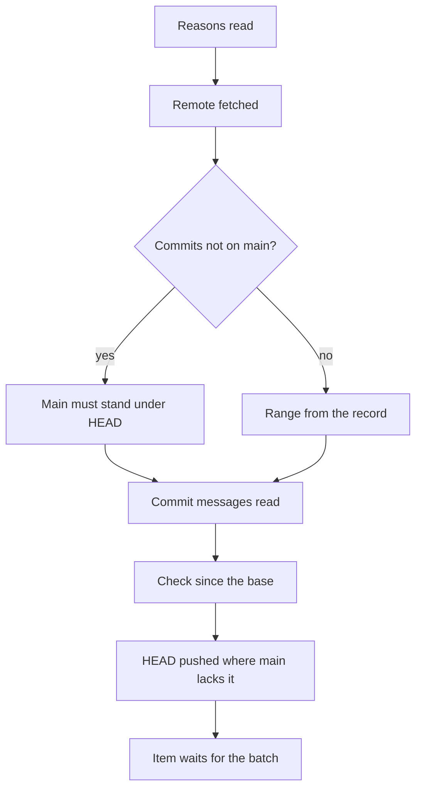

# The command line

The binary `bmo-job` carries these commands.

| Command | Does |
|---|---|
| `bmo-job nouns` | Every noun this unit carries (`job`, `job ask` and `todo`), one a line, `job ask` marked `home` after a tab, which `bmo` reads to find the commands it hands this unit |
| `bmo-job serve` | Serves the API by the settings file (docs/settings.md) until it is told to stop by an interrupt or a termination signal; every open event stream ends then, so the stop is not held |
| `bmo-job mcp --service <url>` | Serves the harness plugin's MCP server on standard input and output, reaching the service at the address (docs/api.md, "The harness plugin") |
| `bmo-job job close` | Checks what the job changed, merges its commits onto the remote's main and leaves the item waiting for its repository's batch deployment (「`bmo-job job close`」) |
| `bmo-job job ask` | Puts a choice to the owner in the middle of a job and waits for a person to settle it (「`bmo-job job ask`」) |
| `bmo-job todo` | Closes an item, holds it with the run's account on it, or raises a new one, each through the service's own routes (「`bmo-job todo`」) |
| `bmo-job openapi` | Prints the OpenAPI document, the one committed as `docs/openapi.json` |

## `bmo-job job close`

`bmo job close --then '<why this goes live, in English>' [--todo <item>] [--skip-suite '<why, in English>']` runs this, through
the unit command the deployment links into `~/.local/bin` (docs/deploy.md, "The unit command").

| Option | What it does |
|---|---|
| `--then <why>` | Why this goes live, in English; required. A reason holding Hangul is refused |
| `--skip-suite <why>` | Read as a reason, English like `--then`, and nothing more: the close runs no suite, so it changes nothing, and the close says so in one line |
| `--todo <item>` | The item the job works on; the close writes where it stands onto that item (below) |

A close ends at the merge. It checks what the job changed, puts the job's commits on the remote's main, marks
the item waiting for its repository's batch deployment and ends; it runs no suite, waits for no deployment and
confirms nothing live. The suite, the deployment and the live check are the batch deployment's, which puts every
commit waiting on main live at once, its gate running the suite once for all of them (docs/deploy.md, "What gates
a deployment").

- **The main it lands on.** The remote is the one the checkout's branch follows, else `origin`; its main is the
  remote's `main`, else its `master` where the remote holds no `main`. The close fetches that remote first, and
  a remote that cannot be read refuses the close with what git said.
- **The job's own commits.** Where `HEAD` holds commits the remote's main does not, those are the job's own, and
  the base is the remote's main. A branch the remote's main has moved past, so that it no longer stands under
  `HEAD`, is refused with the command that brings it up: the close merges by fast-forward alone and never
  rewrites the checkout.
- **A commit already on main.** Where the remote's main already holds `HEAD`, nothing is pushed, and the range is
  read from the deployment record (docs/deploy.md, "A job closes"): the job's commits are those past the commit
  the record names as live. Where the record's commit is not in the repository or is no ancestor of `HEAD`, the
  range is taken from the job's own base commit instead, and the close says in one line which range it used. A
  commit the record already names as live runs nothing and ends clean.
- **What is refused before the check.** A commit of the range whose message holds Hangul, each such commit named
  with the command that rewords it; nothing is checked, pushed or written on the item.
- **The check.** `bmo-testbed check --since <base>`, which `bmo check --since` runs, runs in the checkout: the
  check a change owes over every path changed since the base (bmo-testbed's `docs/checks.md`). A check that does
  not pass refuses the close with exit 1, and nothing is pushed.
- **The merge.** Once the check passes, the job's commits are pushed onto the remote's main as `HEAD` stands. A
  push the remote refuses, its main having moved while the check ran, refuses the close with what git said and
  the way to close again; nothing is written as waiting.
- **Where the close stands is written on the item `--todo` names,** as two of its labels, the rest of its labels
  kept: `close-phase` is `testing` from the moment the check starts and `waiting-batch` once the commit stands on
  main, and `close-commit` is that commit, written with `waiting-batch`. A reader of the queue tells from them an
  item whose work is being checked from one whose commit waits on main for its repository's batch deployment.
  Taking them off once the commit is live is the deployer's, as is the batch deployment itself.
- **Both labels are taken off** where the close is refused, where its check does not pass, where its push is
  refused, where the close is told to stop, where the commit is already what is deployed, and where the
  repository deploys nothing, so an item carries them only while its check runs or its commit waits.
- **The item is reached as `bmo-job todo` reaches it** (「`bmo-job todo`」), and a restart is no answer. While
  the service does not answer, nothing at its address, a connection cut, a 5xx or a request left unanswered for
  ten seconds, its labels are written again, after a quarter of a second at first and every five seconds at
  most. The close goes on once they are written, once two minutes have passed with no answer, or once the run
  is told to stop; the last two are said in one line. An item the service refuses, one it does not hold or a
  change it will not take, stops no close: the close says so in one line and goes on.
- **A close with no `--todo` writes on no item.**
- **The check is watched.** It is started in the checkout, in a process group of its own, its standard output
  and error read through pipes and written on as they come. It is handed `BMO_TESTBED_HEARD`, naming a file of
  the close's own, which the testbed touches while a command it watches writes but holds its output back; a
  touch counts as output.
- **A check that falls silent ends the close.** A check that writes nothing and touches nothing for the close's
  silence limit is hung. The limit always stands five minutes above bmo-testbed's own bound on a silent unit,
  so the testbed ends a hung unit first and names it, and the close's limit catches what the testbed does not
  watch. Where the checkout's `testbed.toml` declares `[test] silence_seconds`, the close's limit is that many
  seconds and five minutes more; where it declares none, or its declaration does not read, the testbed keeps
  its ten-minute default and the close's limit is fifteen minutes. The close names every process still running under the check, in its process
  group or below it, sends each a TERM, and a KILL to whatever stands ten seconds later. It then reads the
  checkout's `git status` against what it read before the check, and refuses the close with the check's last
  line, what was still running, and whether the checkout stands as it found it or which paths differ:
  `job-close: refused — the static check wrote nothing for 900s and was ended`, the seconds being the limit
  the close kept to. The close itself writes nothing
  in the checkout.
- **A running close says where it stands.** Every minute while the check runs, one line on standard output
  names it, how long it has run, how long ago its output last moved and its last line, so a reader tells a slow
  check, whose output moves, from a wedged one, whose does not. Whatever ends the close, its last line on
  standard output is `job-close: ended, exit <code>`, so a caller reading its log needs no process listing to
  know it has ended.
- **Every wait inside a close has a clock the code names.** Each request writing the item's labels waits ten
  seconds and the writing as a whole two minutes; each local `git` call one minute, and the fetch
  and the push five minutes each, after which it is ended and read as failed; the check's silence fifteen
  minutes, or five more than the checkout's declared testbed silence, and the pause before the KILL ten seconds; the running check is looked at every second.
- **Told to stop, a close ends the check it runs first,** every process under it as for a hung check, so
  nothing it started goes on after it.
- **What the close says is the account of its close.** A close that ends at the merge prints, before its last
  line, the commits it put on main, each as its short commit and subject, and the check that passed with the
  base it ran from. That is what a job's report says of its close: what changed and what was checked, and that
  the commit waits for its repository's batch deployment.
- **How it ends:**

  | What happened | Standard output | Standard error | Exit |
  |---|---|---|---|
  | The check passed and the commit stands on main, its repository deploying | `merged:` with the commits, `checked:` with the check, and `waiting for the batch deployment: <commit> stands on <remote>/<main>` | | 0 |
  | The same in a repository whose `testbed.toml` reads and declares no `[deploy]` (a base library, released and never put live) | `merged:`, `checked:`, and `on main: <commit> stands on <remote>/<main>, and this repository deploys nothing` | | 0 |
  | The record already names the commit as live | `this commit is already what is deployed` | | 0 |
  | A reason, a commit message, the remote, a branch main has moved past, the check or the push refused it | | `job-close: refused —` and why | 1 |
  | The run was told to stop | | one line saying so | 130 |

## `bmo-job job ask`

`bmo job ask` runs this. It is what a job's own run waits on: nothing ends the wait but what is listed here, and
no clock is among it.

| Form | What it does |
|---|---|
| `--todo <item> --question <words> --option <words> --option <words> --recommend <n> --why <words>` | Opens the question in the owner's private room, puts it to him and waits |
| `--talk <question> --say <words>` | Puts the job's answer to his talk in the same room, then waits on the same question |
| `--talk <question> --say <words> --option <words> --option <words> --recommend <n> [--question <words>] [--why <words>]` | The same, with the question put again in other words |

- **How it ends:**

  | What happened | Standard output | Standard error | Exit |
  |---|---|---|---|
  | A person settled it | One line: the option's words, or his own | | 0 |
  | He talked instead of choosing; the question stays open | His words and the call that answers him | | 3 |
  | The question could not be put, the receiver refusing it; it is closed `unsent` | Nothing | Why | 1 |
  | The question was withdrawn, or the run was told to stop, which withdraws a question already opened | Nothing | Why | 1 |
  | The words were refused; no question opened | Nothing | Why, and the usage | 1 |

- **A recommendation is shown and never answers.** It is printed only where a person settled the question with
  it. A settling reply no person gave is refused: the verb ends 1 and prints no option.
- **Putting the question.** The verb reads the owner's private room from the receiver's `GET /owner`, opens the
  question there with `toldByAsker` (docs/api.md, "Questions and replies"), and hands it to the room's supervisor
  through the receiver's `POST /instructions`, an order under the sort `job` of the kind
  `question-awaits-answer`. An answer other than a queued instruction is a failed send. A question that is settled or
  stopped has its instruction withdrawn where it has not reached the supervisor yet.
- **What a turn carries.** An order carries the notice's kind and number, the item's number and title, and the data
  it is about: the question and its options numbered with the recommended one marked, or the job's words in a talk,
  with the question's words and options again where the talk changed it. It carries no instruction, since how a
  notice is read stands in the receiving session's own instructions.
- **A restart is no answer.** Every call the verb makes, reading the owner's room, opening the question,
  reading the item's title, handing the order or the talk over, keeping the job's words and where it heard
  through, closing the question, and every read while it waits, is made again while the service or the
  receiver does not answer: nothing at its address, a connection cut, or a 5xx. It is made again after a
  quarter of a second at first and every five seconds at most. The run told to stop ends it as above. Only an
  answer ends a call: while the question is put, a refusal closes it `unsent`; while it is waited on, only a
  question the service no longer holds ends the wait, with 1.
- **At least once.** A call cut after its peer took it is made again, so an order or the job's words in a talk
  can reach the room twice. A question is opened once: where opening it was cut, the room's open questions
  are read first, and one of the same asker, item, words and options is taken as the one opened.
- **The due time.** The question is asked with the service's own due time, a minute where the service names no
  other, which paces the one notice
  `question.due` tells and settles nothing.
- **Pages hosted elsewhere are refused:** an address of a claude.ai artifact, a published Claude page, a gist or a
  paste in the question, an option, the reason or the words of a talk.
- **Where it reaches the receiver:** `BMO_RECEIVER_URL` with `BMO_RECEIVER_TOKEN` or `BMO_RECEIVER_TOKEN_FILE` in
  the run's environment, else `RECEIVER_ADDRESS` and `RECEIVER_TOKEN` in `env/receiver.env` under the data root.

## `bmo-job todo`

The worker's run already names the job service in `BMO_JOB_URL` and its token in `BMO_JOB_TOKEN` or `BMO_JOB_TOKEN_FILE`; a shell with neither reads the deployment's `settings.toml` beside the binary, or the file `BMO_JOB_SETTINGS` names.

| Form | What it does |
|---|---|
| `--done <item> [--report <text>] [--unfinished <text>]` | Leaves the run's account of the finished work on the item: `--report` kept as a `final` report and `--unfinished` as a `held` one through `POST /items/{itemId}/reports`. It moves no state: the item is done once whoever ordered the work takes it — its review, or, for an item whose commit waits on main for its repository's batch deployment (its label `close-phase` reading `waiting-batch`, 「`bmo-job job close`」), whoever puts that commit live. The verb prints one line saying what the item waits on: `deployment` with the commit, `review`, or `orderer` |
| `--stop-here <item> --report <text>` | Leaves the run's account on the item as a `held` report, for the run that picks the work up: what is finished and where the next run goes on. It moves no state; holding the item is its orderer's |
| `--add --title <words> --judgement <words> --raised-by <item> [--repository <name>] [--from-todo <id>:<strand>[,<id>:<strand>]]` | Raises a draft in the queue and scope of the item it was raised from, the judgement as its brief, `--repository` as its assignee (the repository its work is in), else the assignee of the item it was raised from, and `--from-todo` as its label `from-todo`, and prints it |

- **`--by <name>`** names who writes it: the run's `BMO_TURN_AGENT` where left out, then `USER`.
- **Pages hosted elsewhere are refused** in a `--report` and an `--unfinished`, as in a question.
- **Each answer is printed as JSON,** one a line. The verb reads no database of its own.
- **A run never moves its own item's state.** Whether the item is done, held or open again is decided by whoever
  ordered the work, through the service's routes; the verb leaves the run's words on the item and nothing else.

## `bmo-job mcp`

| Option | What it gives |
|---|---|
| `--service <url>` | The base address the service's routes stand at; required |
| `--token <token>` | The bearer token every call is made with: the shared token, or a caller's own, under whose name the service records an approval the server gives (docs/settings.md, `[callers]`); read from `BMO_JOB_TOKEN` where it is left out |
| `--holder <name>` and `--queue <name>` | A holder name and the queues it is told of from the start, `--queue` given once for each; each needs the other |
| `--channel <capability>` | The experimental capability each event is also pushed on as a message |
| `--without <tools>` | Tools the server leaves out, their names comma-separated, the option given once or more; read from `BMO_JOB_MCP_WITHOUT` where it is left out. A tool left out is neither listed nor called; a name that is no tool of the plugin refuses the start |

The server ends when the harness closes its input, and then gives back the leases and deletes the
subscriptions it kept, waiting for the service to answer each.
